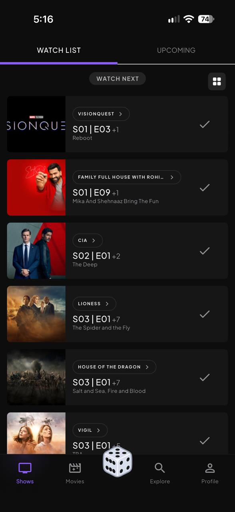
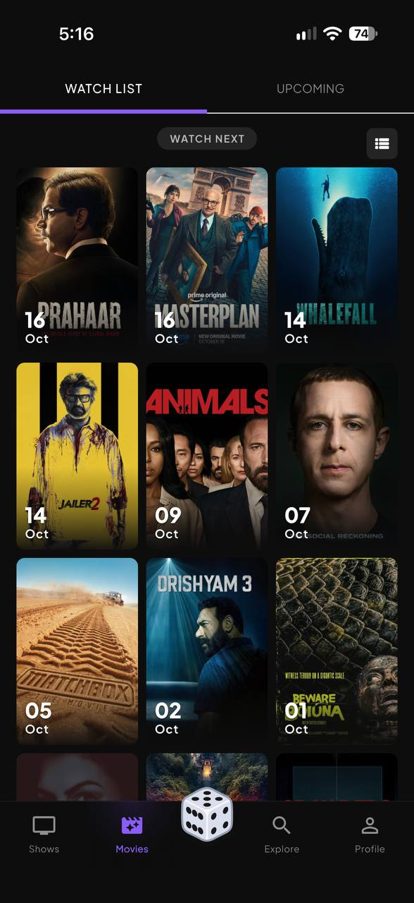
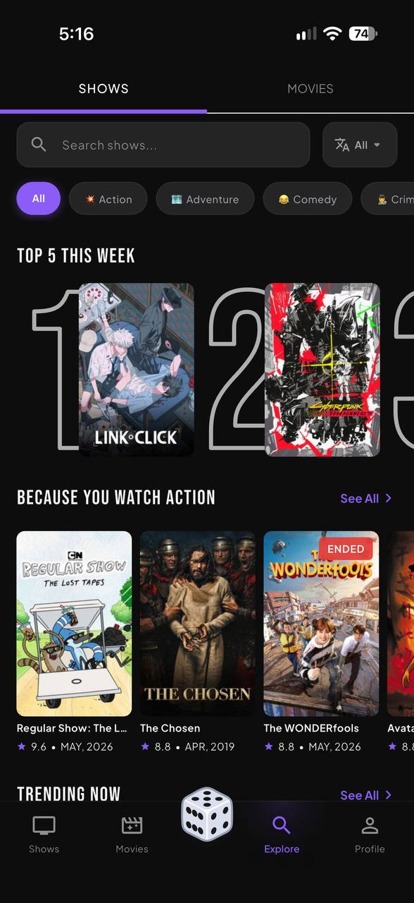
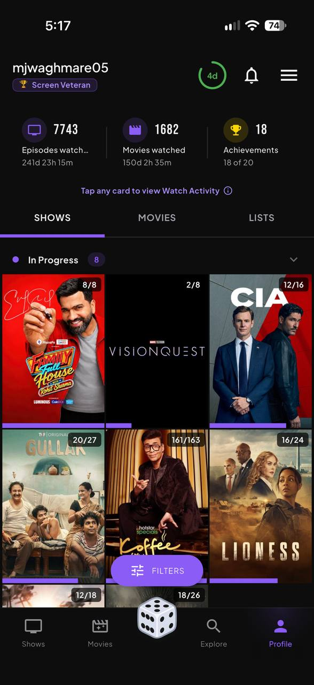

# 🎬 PopVerse

  

  <strong>Track TV shows & movies, manage watchlists, discover trending content, and never miss an episode.</strong>

---

## 📸 Screenshots

<table align="center">
  <tr>
    <th align="center">Shows</th>
    <th align="center">Movies</th>
    <th align="center">Explore</th>
    <th align="center">Profile</th>
  </tr>
  <tr>
    <td align="center"></td>
    <td align="center"></td>
    <td align="center"></td>
    <td align="center"></td>
  </tr>
</table>

---

## ✨ Features

### 📺 Tracking & Details
- **Watchlists & Progress**: Mark episodes and movies as watched, track seasons, and resume where you left off.
- **Rich Metadata**: Access episode guides, countdown timers, cast & crew, ratings, and embedded trailers.
- **Streaming Availability**: See where content is streaming across OTT platforms (Netflix, Prime Video, Disney+, etc.).

### 🔍 Discovery & Search
- **Curated Feeds**: Browse top-rated, popular, and upcoming releases powered by TMDB.
- **Surprise Picks**: Shake your device for instant randomized recommendations.
- **Instant Search**: Look up movies, TV series, and cast members.

### 🏆 Statistics & Milestones
- **Badges & Achievements**: Unlock milestones for completing series, seasons, and binge sessions.
- **Viewing Analytics**: Interactive charts showing total watch time, favorite genres, monthly breakdown, and completion rates.

### 🔔 Notifications & Widgets
- **Air Date Alerts**: Timely notifications for upcoming season and episode premieres.
- **Home Screen Widgets**: Quick glance at your next unwatched episodes directly from your home screen.

### ☁️ Sync & Data Portability
- **Cloud Sync**: Sign in with Google to synchronize your library across devices.
- **Import & Export**: Migrate watch history from **TV Time** / Trakt (CSV/ZIP) or export backups anytime.

### 🎨 Design & Experience
- **Polished UI**: Modern glassmorphic interface with custom navigation and smooth micro-animations.
- **Theme Support**: Seamless Dark and Light modes.
- **In-App Updates**: Automated version checks and update alerts.
