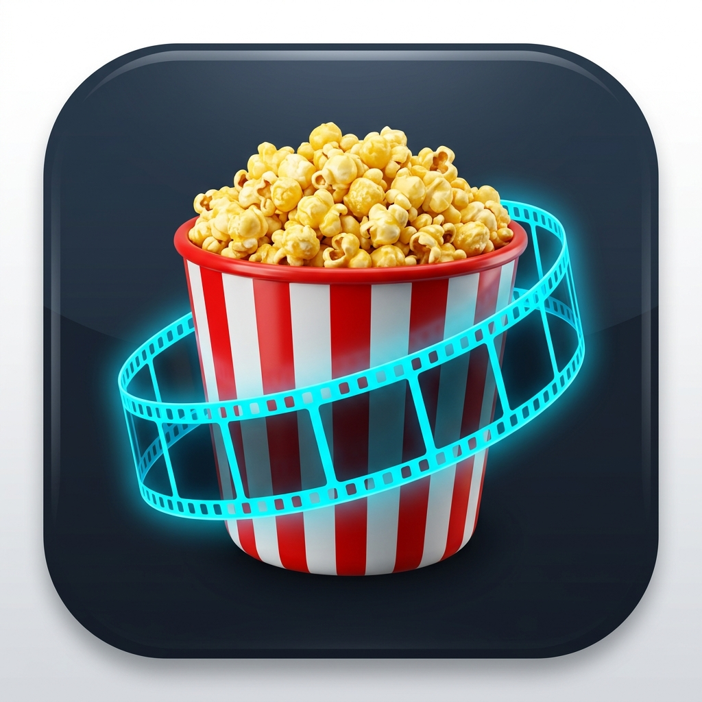

# 🎬 PopVerse

<p align="center">
  
</p>

<p align="center">
  <strong>Track your favorite TV shows & movies, manage watchlists, discover trending content, and never miss an episode.</strong>
</p>

<p align="center">
  <a href="#features">Features</a> •
  <a href="#tech-stack">Tech Stack</a> •
  <a href="#architecture">Architecture</a> •
  <a href="#getting-started">Getting Started</a> •
  <a href="#folder-structure">Folder Structure</a> •
  <a href="#contributing">Contributing</a>
</p>

<p align="center">
  
  
  
  
  
</p>

---

## ✨ Features

### 📺 Track TV Shows & Movies
- **Watchlist & Progress Tracking**: Easily mark episodes and movies as watched, plan upcoming watchlists, and resume right where you left off.
- **Detailed Information**: View episode guides, air dates, countdown timers, cast & crew, ratings, and embedded YouTube trailers.
- **Streaming Providers**: Find out which OTT platforms (Netflix, Prime, Disney+, etc.) stream your favorite content.

### 🔍 Discovery & Explore
- **Trending & Popular**: Browse top-rated, trending, and upcoming movies and shows updated in real-time via TMDB.
- **Shake for Surprise**: Shake your device to get randomized, personalized movie/show recommendations.
- **Advanced Search**: Debounced instant search across movies, TV series, and actors.

### 🏆 Gamification & Deep Statistics
- **Badges & Achievements**: Unlock milestones as you watch more shows, complete full series, or log binge sessions.
- **Interactive Stats & Charts**: Detailed charts (via `fl_chart`) visualizing total hours watched, favorite genres, monthly breakdown, and completion rates.

### 🔔 Smart Notifications & Home Widgets
- **Air Date Reminders**: Automated background reminders (`workmanager` & `flutter_local_notifications`) for upcoming season and episode premieres.
- **Home Screen Widgets**: Glanceable home screen widgets (`home_widget`) displaying your next unwatched episodes.

### ☁️ Sync, Import & Export
- **Cloud Sync**: Seamless user authentication with Google Sign-In and cloud sync via Firebase Firestore.
- **Data Import**: Migrate existing watch history from **TV Time** / Trakt via CSV/ZIP import.
- **Backup & Export**: Export your complete watch history anytime.

### 🎨 Modern & Polished UI
- **Glassmorphic Aesthetics**: Modern design with customized liquid navigation bars and smooth micro-animations (Lottie).
- **Theme Support**: Adaptive Dark Mode and Light Mode respecting design system color tokens.
- **In-App Update Service**: Automated version checking and in-app update alerts.

---

## 🛠️ Tech Stack & Dependencies

- **Framework**: [Flutter](https://flutter.dev) (Dart 3)
- **State Management**: [flutter_bloc](https://pub.dev/packages/flutter_bloc) / Cubit & [Equatable](https://pub.dev/packages/equatable)
- **Backend & Auth**: [Firebase Core](https://pub.dev/packages/firebase_core), [Cloud Firestore](https://pub.dev/packages/cloud_firestore), [Firebase Auth](https://pub.dev/packages/firebase_auth), [Google Sign-In](https://pub.dev/packages/google_sign_in)
- **Networking**: [Dio](https://pub.dev/packages/dio) with custom interceptors & error handlers
- **Routing**: [go_router](https://pub.dev/packages/go_router)
- **Local Storage & Cache**: [shared_preferences](https://pub.dev/packages/shared_preferences), [cached_network_image](https://pub.dev/packages/cached_network_image)
- **UI & Animations**: [Skeletonizer](https://pub.dev/packages/skeletonizer), [Lottie](https://pub.dev/packages/lottie), [Google Fonts](https://pub.dev/packages/google_fonts), [fl_chart](https://pub.dev/packages/fl_chart)
- **Hardware & Native**: [shake](https://pub.dev/packages/shake), [home_widget](https://pub.dev/packages/home_widget), [workmanager](https://pub.dev/packages/workmanager), [flutter_local_notifications](https://pub.dev/packages/flutter_local_notifications)

---

## 📐 Architecture

PopVerse follows **Clean Architecture** with a feature-first structure:

```
lib/
├── core/                   # Shared utilities, services, theme, and global widgets
│   ├── network/            # Dio client & API configurations
│   ├── services/           # Notifications, Home Widgets, App Update, Background Sync
│   ├── theme/              # Design system tokens (AppColors, AppTextStyles, AppSpacing)
│   └── widgets/            # Reusable UI components
├── features/               # Feature-first modules
│   ├── auth/               # Authentication & session handling
│   ├── dashboard/          # Home watchlist, upcoming feed & quick actions
│   ├── explore/            # Discovery feeds, category carousels & surprise mode
│   ├── show_details/       # TV show and episode breakdown, trailers, cast
│   ├── movies/             # Movie tracking & details
│   ├── search/             # Multi-category instant search
│   ├── profile/            # User stats, achievements, settings & notifications
│   └── import/             # CSV / TV Time backup importer
└── main.dart               # App entrypoint, dependency initialization & service setup
```

Each feature is organized into layers:
- **`data/`**: Models, API data sources, and repository implementations.
- **`domain/`**: Business entities and use cases.
- **`presentation/`**: Cubits/BLoCs, state definitions, and UI pages/widgets.

---

## 🚀 Getting Started

### Prerequisites
- [Flutter SDK](https://docs.flutter.dev/get-started/install) (version `^3.12.0` or higher)
- [Dart SDK](https://dart.dev/get-dart)
- Android Studio / Xcode for device emulators
- A TMDB API Key from [themoviedb.org](https://www.themoviedb.org/documentation/api)
- A configured [Firebase Project](https://firebase.google.com/)

### 1. Clone the Repository
```bash
git clone https://github.com/your-username/popverse.git
cd popverse
```

### 2. Configure Environment Variables
Create a `.env` file in the root directory:
```env
TMDB_API_KEY=your_tmdb_api_key_here
TMDB_BASE_URL=https://api.themoviedb.org/3
TMDB_IMAGE_BASE_URL=https://image.tmdb.org/t/p
```

### 3. Setup Firebase
- Add your `google-services.json` to `android/app/`
- Add your `GoogleService-Info.plist` to `ios/Runner/`

### 4. Install Dependencies & Run
```bash
# Get dependencies
flutter pub get

# Run the app
flutter run
```

---

## 📱 Screenshots

| Home / Watchlist | Explore & Discover | Show Details | Statistics & Badges |
| :---: | :---: | :---: | :---: |
| *(Add screenshot)* | *(Add screenshot)* | *(Add screenshot)* | *(Add screenshot)* |

---

## 🤝 Contributing

Contributions are welcome!
1. Fork the Project
2. Create your Feature Branch (`git checkout -b feature/AmazingFeature`)
3. Commit your Changes (`git commit -m 'Add some AmazingFeature'`)
4. Push to the Branch (`git push origin feature/AmazingFeature`)
5. Open a Pull Request

---

## 📄 License

Distributed under the MIT License. See `LICENSE` for more information.
